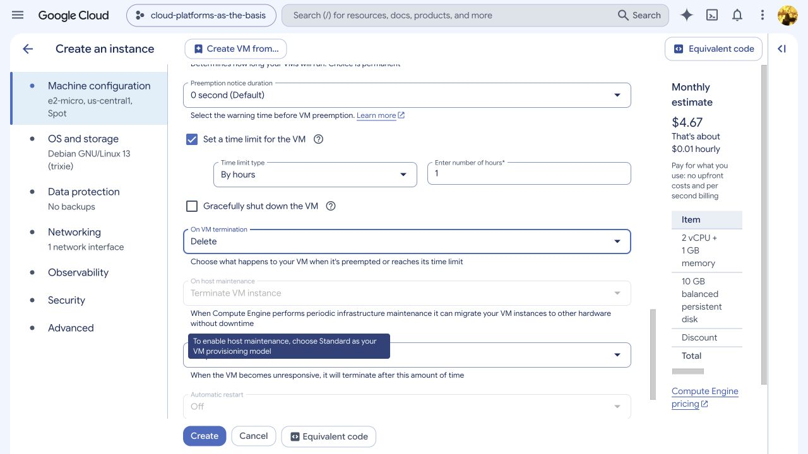
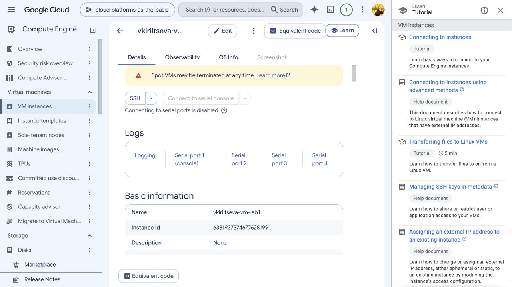
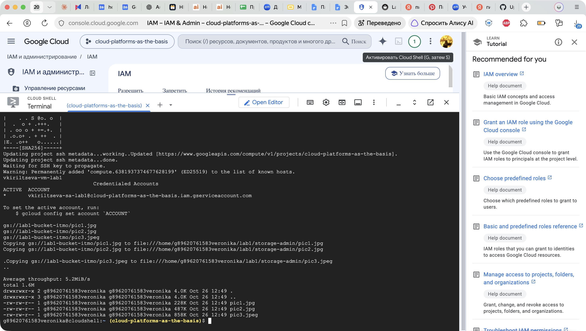
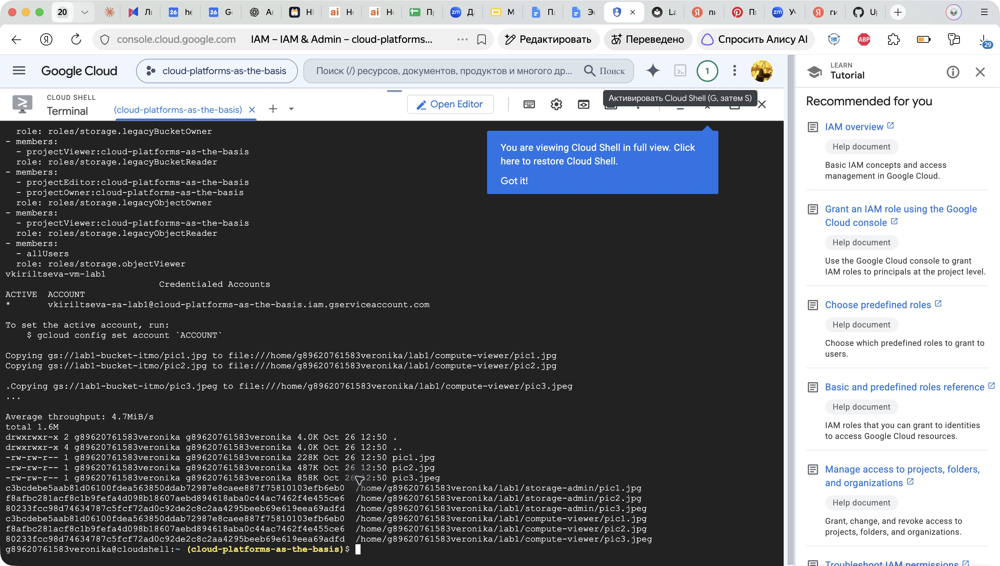
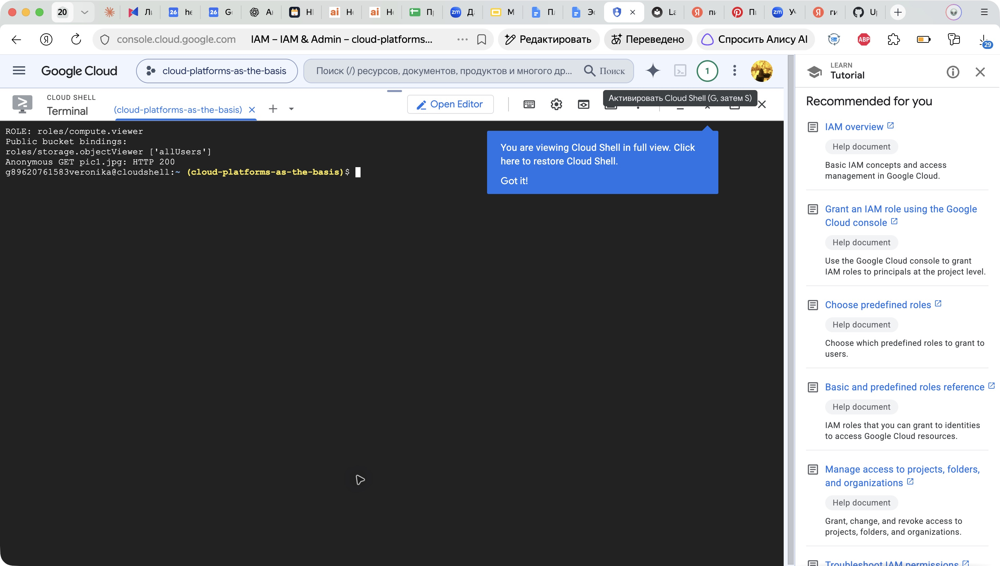
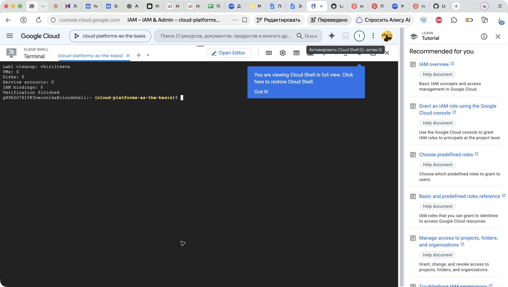

# Лабораторная работа №1. Обзор Google Cloud и исследование основных сервисов

University: [ITMO University](https://itmo.ru/ru/)  
Faculty: [FICT](https://fict.itmo.ru)  
Course: [Cloud platforms as the basis of technology entrepreneurship](https://ex-itmo-ict-faculty.github.io/cloud-platforms-as-the-basis-of-technology-entrepreneurship/)  
Year: 2026  
Group: U4225  
Author: Кирильцева Вероника Сергеевна  
Lab: Lab1  
Date of create: 26.10.2026  
Date of finished: не защищена

[К списку отчётов](../README.md) · [Задание](https://ex-itmo-ict-faculty.github.io/cloud-platforms-as-the-basis-of-technology-entrepreneurship/education/labs2023-2024/lab1/lab1/)

**Статус:** практическая часть выполнена 26.10.2026; ресурсы удалены; отчёт подготовлен к защите.

## Цель работы

Ознакомиться с основными возможностями Google Cloud, создать сервисный аккаунт и виртуальную машину, исследовать влияние ролей IAM на доступ к Cloud Storage.

## Использованные ресурсы

| Параметр | Значение |
| --- | --- |
| Учебный проект | `cloud-platforms-as-the-basis` |
| Номер проекта | `307056602443` |
| Сервисный аккаунт | `vkiriltseva-sa-lab1@cloud-platforms-as-the-basis.iam.gserviceaccount.com` |
| Виртуальная машина | `vkiriltseva-vm-lab1` |
| Тип и режим | `e2-micro`, Spot |
| Зона | `us-central1-a` |
| ОС | Debian GNU/Linux 13 (trixie) |
| Загрузочный диск | 10 ГБ, balanced persistent disk |
| Учебный бакет | `gs://lab1-bucket-itmo` |

Вход выполнен под Google-аккаунтом автора. Доступ к учебному проекту уже был предоставлен; повторная отправка формы не потребовалась. Преподаватель подтвердил, что покрывает расходы на лабораторную и требует удалить ресурсы после выполнения.

## Ход работы

### 1. Создание сервисного аккаунта и назначение роли

В разделе **IAM & Admin → Service Accounts** создан аккаунт `vkiriltseva-sa-lab1`. Имя составлено из первой буквы имени, фамилии и суффикса `-sa-lab1`.

Аккаунту назначена роль **Storage Admin** (`roles/storage.admin`). Ключи сервисного аккаунта не создавались: VM использует подключённый сервисный аккаунт через механизм Google Cloud.

Назначение проверено из Cloud Shell:

```bash
gcloud projects get-iam-policy cloud-platforms-as-the-basis \
  --flatten='bindings[].members' \
  --filter='bindings.members:serviceAccount:vkiriltseva-sa-lab1@cloud-platforms-as-the-basis.iam.gserviceaccount.com' \
  --format='table(bindings.role)'
```

Получен результат `ROLE: roles/storage.admin`.

### 2. Создание виртуальной машины

В **Compute Engine → Create an instance** создана VM `vkiriltseva-vm-lab1` типа `e2-micro` с моделью предоставления **Spot**. К VM подключён созданный сервисный аккаунт. Использованы стандартные access scopes, включая `devstorage.read_only`; для требуемого чтения файлов этого достаточно.

Для временной лабораторной не включались дополнительные диски, расписания снимков и установка Ops Agent. Задано ограничение времени работы **3600 секунд** с действием **DELETE**. Это резервная мера: после эксперимента VM удалена вручную раньше истечения часа.



После создания состояние проверено командой:

```bash
gcloud compute instances describe vkiriltseva-vm-lab1 \
  --project=cloud-platforms-as-the-basis --zone=us-central1-a \
  --format='yaml(name,status,machineType,scheduling,serviceAccounts,disks)'
```

Проверка подтвердила `status: RUNNING`, тип `e2-micro`, `provisioningModel: SPOT`, `automaticRestart: false`, `maxRunDuration.seconds: 3600`, `instanceTerminationAction: DELETE` и нужный сервисный аккаунт.



### 3. Копирование файлов при Storage Admin

Из Cloud Shell выполнено подключение к VM через `gcloud compute ssh`. Внутри VM проверены имя машины и активная учётная запись, найден бакет и скопированы три файла:

```bash
hostname
gcloud auth list
mkdir -p ~/lab1/storage-admin
gcloud storage ls gs://lab1-bucket-itmo
gcloud storage cp \
  gs://lab1-bucket-itmo/pic1.jpg \
  gs://lab1-bucket-itmo/pic2.jpg \
  gs://lab1-bucket-itmo/pic3.jpeg \
  ~/lab1/storage-admin/
ls -lah ~/lab1/storage-admin/
```

`hostname` вывел `vkiriltseva-vm-lab1`. В `gcloud auth list` активным указан сервисный аккаунт `vkiriltseva-sa-lab1`, поэтому запросы к Storage выполнялись от его имени, а не от имени пользователя Cloud Shell.

| Файл | Размер в `ls -lah` |
| --- | --- |
| `pic1.jpg` | 228K |
| `pic2.jpg` | 487K |
| `pic3.jpeg` | 858K |

Все три файла успешно загружены в локальную папку **на VM**.



### 4. Замена роли на Compute Viewer

Из Cloud Shell удалена роль Storage Admin и назначена Compute Viewer:

```bash
gcloud projects remove-iam-policy-binding cloud-platforms-as-the-basis \
  --member=serviceAccount:vkiriltseva-sa-lab1@cloud-platforms-as-the-basis.iam.gserviceaccount.com \
  --role=roles/storage.admin --condition=None --quiet

gcloud projects add-iam-policy-binding cloud-platforms-as-the-basis \
  --member=serviceAccount:vkiriltseva-sa-lab1@cloud-platforms-as-the-basis.iam.gserviceaccount.com \
  --role=roles/compute.viewer --condition=None --quiet
```

Повторная проверка IAM показала только `roles/compute.viewer` для этого сервисного аккаунта.

### 5. Повторное копирование и анализ результата

После смены роли выполнено новое подключение к той же VM. Файлы скопированы в **другую папку**, чтобы не принять старые файлы за результат повторной загрузки:

```bash
hostname
gcloud auth list
mkdir -p ~/lab1/compute-viewer
gcloud storage cp \
  gs://lab1-bucket-itmo/pic1.jpg \
  gs://lab1-bucket-itmo/pic2.jpg \
  gs://lab1-bucket-itmo/pic3.jpeg \
  ~/lab1/compute-viewer/
ls -lah ~/lab1/compute-viewer/
sha256sum ~/lab1/storage-admin/* ~/lab1/compute-viewer/*
```

**Фактический результат: повторное копирование также успешно.** Размеры файлов совпали, SHA-256 каждой пары совпал:

| Файл | SHA-256 обеих копий |
| --- | --- |
| `pic1.jpg` | `c3bcdebe5aab81d06100fdea563850ddab72987e8caee887f75810103efb6eb0` |
| `pic2.jpg` | `f8afbc281acf8c1b9fefa4d098b18607aebd894618aba0c44ac7462f4e455ce6` |
| `pic3.jpeg` | `80233fcc98d74634787c5fcf72ad0c92de2c8c2aa4295beeb69e619eea69adfd` |



Чтобы объяснить результат, проверена IAM-политика самого бакета:

```bash
gcloud storage buckets get-iam-policy gs://lab1-bucket-itmo --format=json
```

В ней обнаружена привязка:

```yaml
members:
- allUsers
role: roles/storage.objectViewer
```

Дополнительно выполнен запрос без передачи учётных данных:

```bash
curl -s -o /dev/null \
  -w 'Anonymous GET pic1.jpg: HTTP %{http_code}\n' \
  https://storage.googleapis.com/lab1-bucket-itmo/pic1.jpg
```

Результат: **HTTP 200**. Следовательно, объект действительно доступен анонимно. Публичная роль объясняет сохранение доступа независимо от снятия Storage Admin; успешная загрузка не доказывает наличие прав Storage у Compute Viewer. Влияние задержки распространения IAM отдельно не измерялось, но анонимный HTTP 200 подтверждает независимый путь чтения.



Политика общего учебного бакета не изменялась.

### 6. Удаление ресурсов

После сохранения результатов выполнено удаление VM **вместе с диском**, снята роль Compute Viewer и удалён сервисный аккаунт:

```bash
gcloud compute instances delete vkiriltseva-vm-lab1 \
  --project=cloud-platforms-as-the-basis --zone=us-central1-a \
  --delete-disks=all --quiet

gcloud projects remove-iam-policy-binding cloud-platforms-as-the-basis \
  --member=serviceAccount:vkiriltseva-sa-lab1@cloud-platforms-as-the-basis.iam.gserviceaccount.com \
  --role=roles/compute.viewer --condition=None --quiet

gcloud iam service-accounts delete \
  vkiriltseva-sa-lab1@cloud-platforms-as-the-basis.iam.gserviceaccount.com \
  --project=cloud-platforms-as-the-basis --quiet
```

После удаления выполнены запросы списков ресурсов и IAM-политики. Проверка вернула:

```text
Lab1 cleanup: vkiriltseva
VMs: 0
Disks: 0
Service accounts: 0
IAM bindings: 0
Verification finished
```

Дополнительно из SSH-метаданных проекта удалена ровно одна запись ключа, добавленная для подключения в этой лабораторной; остальные записи сохранены. Общий учебный бакет и чужие ресурсы не удалялись.



## Выводы

Созданы и исследованы сервисный аккаунт IAM, Spot VM Compute Engine и доступ к Cloud Storage через `gcloud`. Все три файла загружены на VM и проверены командой `ls -lah`.

Роль Storage Admin заменена на Compute Viewer. Самостоятельно Compute Viewer не предоставляет права чтения объектов Cloud Storage, однако в данном учебном бакете `allUsers` имеет Storage Object Viewer. Поэтому повторное скачивание осталось успешным; публичность дополнительно подтверждена анонимным HTTP 200.

Практический вывод: доступ к ресурсу нужно оценивать по совокупности применимых разрешений, включая политику самого бакета, а не только по одной роли сервисного аккаунта. Даты защиты в отчёте пока нет — её следует указать после защиты перед преподавателем.
