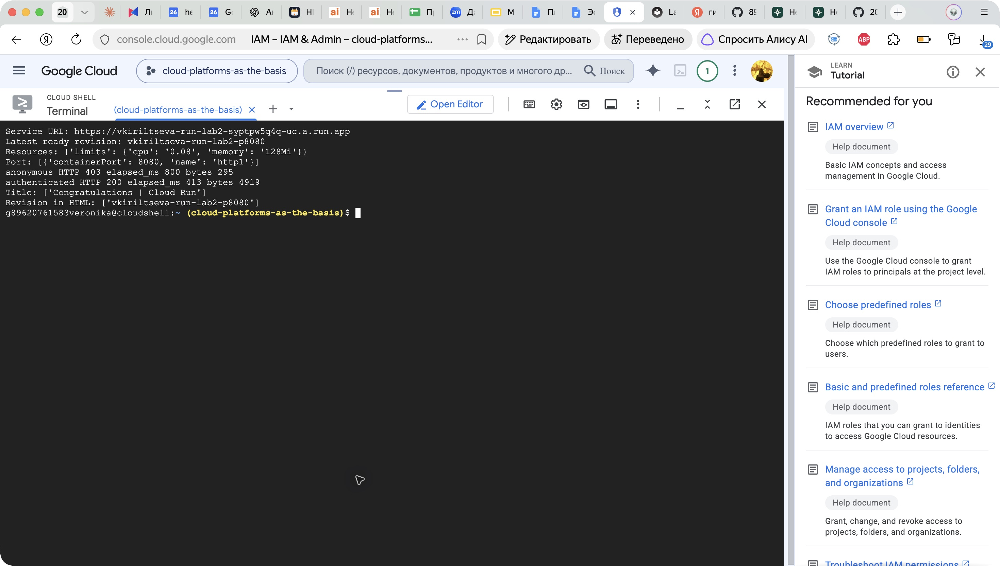
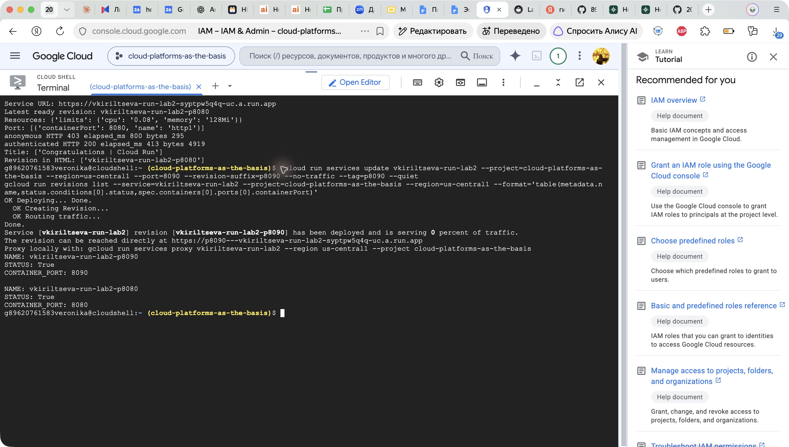
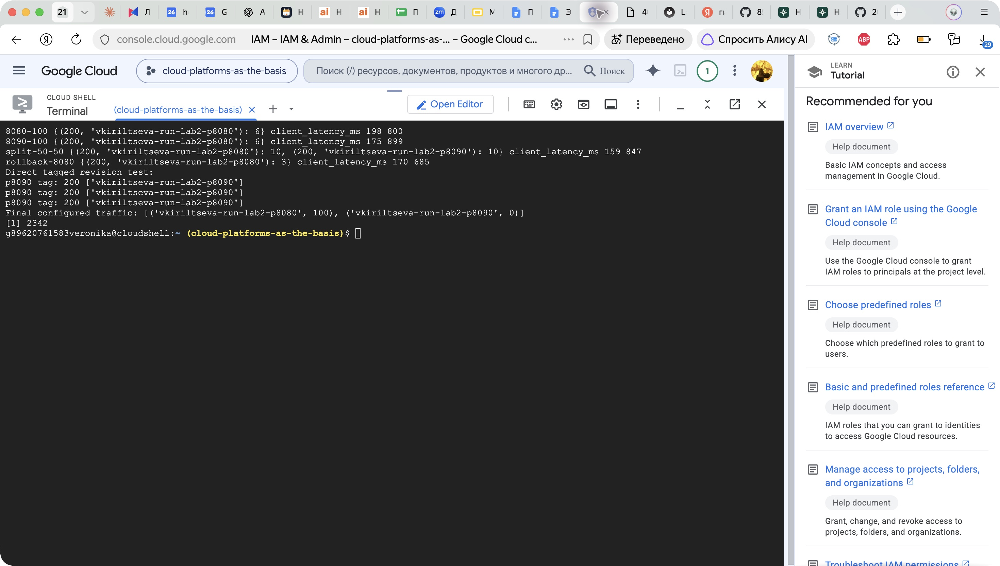
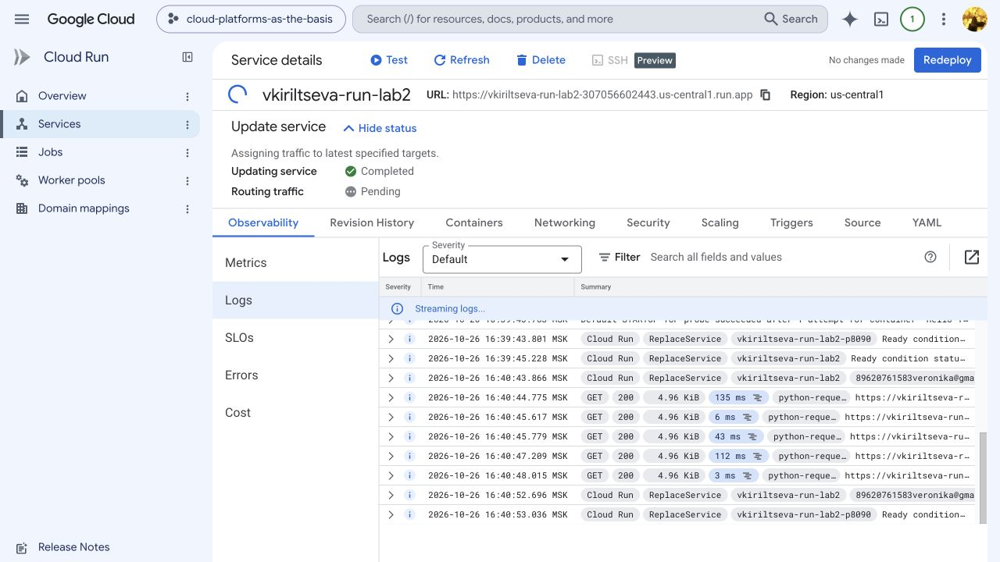
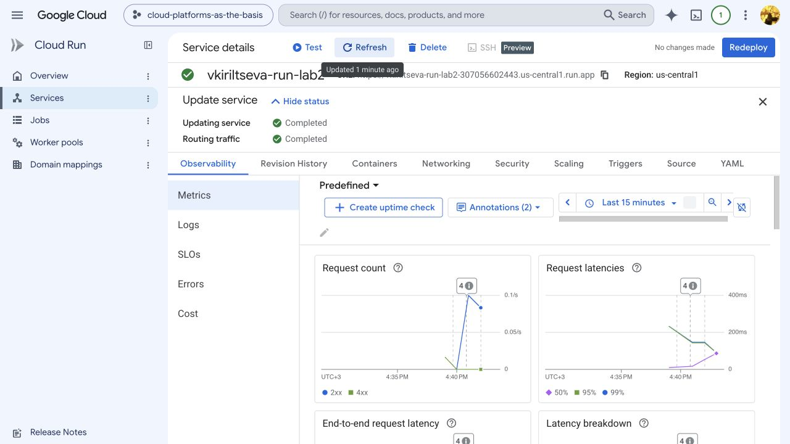
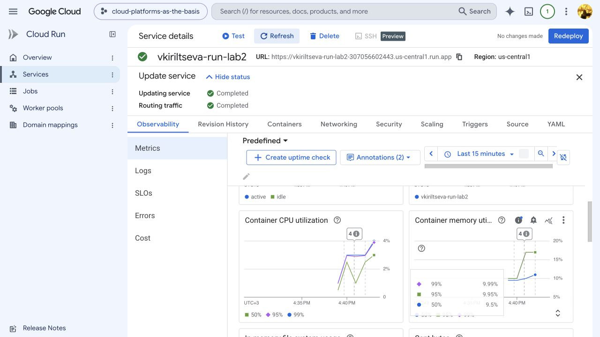
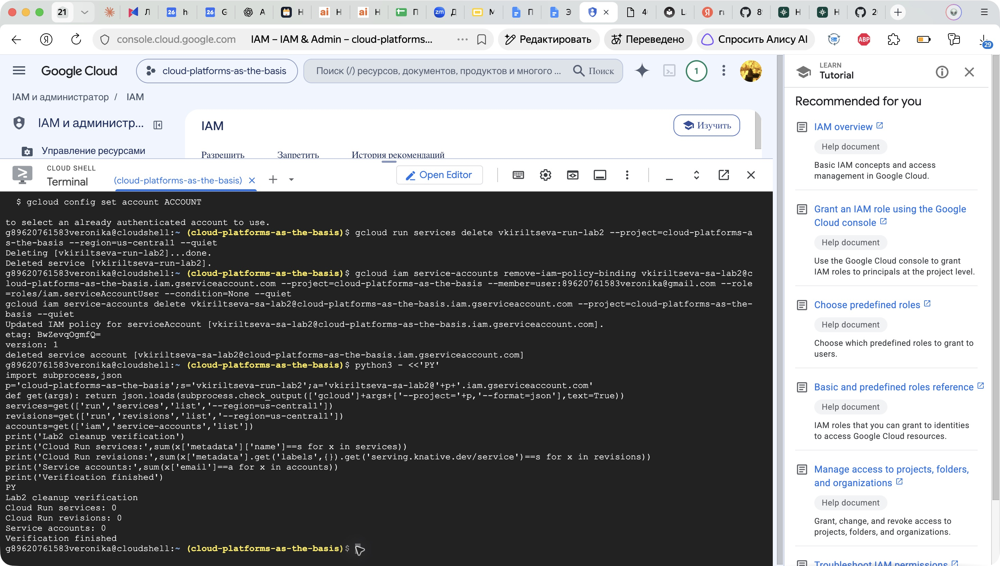

# Лабораторная работа №2. Исследование Cloud Run

University: [ITMO University](https://itmo.ru/ru/)  
Faculty: [FICT](https://fict.itmo.ru)  
Course: [Cloud platforms as the basis of technology entrepreneurship](https://ex-itmo-ict-faculty.github.io/cloud-platforms-as-the-basis-of-technology-entrepreneurship/)  
Year: 2026  
Group: U4225  
Author: Кирильцева Вероника Сергеевна  
Lab: Lab2  
Date of create: 26.10.2026  
Date of finished: не защищена

## Цель работы

Ознакомиться с работой Cloud Run: развернуть контейнер, проверить HTTP-ответы, изучить логи и метрики, изменить порт и распределение трафика между ревизиями.

## Ход работы

### 1. Развёртывание Hello

Работа выполнена в учебном проекте `cloud-platforms-as-the-basis`, регион `us-central1`. Использован стандартный образ `us-docker.pkg.dev/cloudrun/container/hello`.

Создан сервисный аккаунт `vkiriltseva-sa-lab2` без ролей на уровне проекта. Для развёртывания потребовалось разрешение `iam.serviceaccounts.actAs`: роль `Service Account User` временно выдана моей учётной записи только на этот сервисный аккаунт.

Параметры сервиса:

| Параметр | Значение |
|---|---|
| Имя | `vkiriltseva-run-lab2` |
| CPU | 0,08 vCPU |
| Память | 128 MiB |
| Execution environment | gen1 |
| Concurrency | 1 |
| Минимум / максимум экземпляров | 0 / 1 на ревизию |
| Порт первой ревизии | 8080 |
| Доступ | с IAM-аутентификацией |

Использована минимальная конфигурация CPU и памяти. Для CPU менее 1 vCPU выбраны gen1 и concurrency 1. Минимум экземпляров 0 позволяет масштабирование до нуля. Максимум ограничивает масштабирование каждой ревизии; при одновременном использовании двух ревизий это не общий лимит сервиса в один экземпляр.

```bash
gcloud run deploy vkiriltseva-run-lab2 \
  --project=cloud-platforms-as-the-basis --region=us-central1 \
  --image=us-docker.pkg.dev/cloudrun/container/hello \
  --service-account=vkiriltseva-sa-lab2@cloud-platforms-as-the-basis.iam.gserviceaccount.com \
  --cpu=0.08 --memory=128Mi --concurrency=1 \
  --execution-environment=gen1 --min-instances=0 --max-instances=1 \
  --port=8080 --revision-suffix=p8080 --no-allow-unauthenticated --quiet
```

### 2. Проверка сервиса

Cloud Run предоставил URL `https://vkiriltseva-run-lab2-syptpw5q4q-uc.a.run.app`. Запросы выполнены из Cloud Shell с помощью Python `requests`. Для авторизованного запроса использован заголовок `Authorization: Bearer <identity token>`; токен получен командой `gcloud auth print-identity-token` и не выводился в отчёт.

Анонимный запрос вернул **HTTP 403**, авторизованный — **HTTP 200**, HTML размером 4919 байт с заголовком `Congratulations | Cloud Run` и именем ревизии `vkiriltseva-run-lab2-p8080`. Это подтверждает работу приложения и ограничения IAM. Дополнительная попытка открыть Cloud Shell Web Preview завершилась HTTP 401 на самом адресе предпросмотра; это отдельная проблема доступа к предпросмотру, поэтому успешность Cloud Run оценивалась по прямым HTTP-запросам к его URL.



### 3. Изменение порта на 8090

Создана вторая ревизия без перевода на неё основного трафика, с тегом `p8090`:

```bash
gcloud run services update vkiriltseva-run-lab2 \
  --project=cloud-platforms-as-the-basis --region=us-central1 \
  --port=8090 --revision-suffix=p8090 --no-traffic --tag=p8090 --quiet
```

Обе ревизии получили состояние **Ready=True**. Вторая слушает порт 8090. Ошибка запуска не возникла: стандартный Hello учитывает переменную окружения `PORT`, которую устанавливает Cloud Run. Смена порта создаёт новую ревизию, а не изменяет уже запущенную первую ревизию. Если приложение жёстко слушает другой порт, проверка запуска может не пройти; в данном эксперименте такого сбоя не было.



### 4. Переключение трафика

Использована команда `gcloud run services update-traffic` с параметром `--to-revisions`. После каждого обновления выполнялись последовательные авторизованные GET-запросы. Фактическая ревизия определялась по имени в HTML-ответе, а не только по настройке консоли.

| Этап | Настройка трафика | Фактические ответы | HTTP | Задержка клиента, мс |
|---|---|---|---|---|
| Начальный | p8080: 100% | 6 × p8080 | все 200 | 198–800 |
| Перевод на новую | p8090: 100% | 6 × p8080 | все 200 | 175–899 |
| Разделение | p8080: 50%, p8090: 50% | 10 × p8080, 10 × p8090 | все 200 | 159–847 |
| Возврат | p8080: 100% | 3 × p8080 | все 200 | 170–685 |
| Прямой URL тега p8090 | адрес конкретной ревизии | 3 × p8090 | все 200 | не измерялась |

Сразу после установки 100% на p8090 короткая серия ещё обслуживалась p8080. Это наблюдение согласуется с задержкой распространения маршрутизации; оно не доказывает отказ второй ревизии. Последующее распределение 50/50 и три прямых запроса к URL тега подтвердили работоспособность p8090. В небольшой выборке 20 запросов получилось ровно 10/10, но такое равенство не гарантируется для каждой следующей серии.

Пример команды переключения:

```bash
gcloud run services update-traffic vkiriltseva-run-lab2 \
  --project=cloud-platforms-as-the-basis --region=us-central1 \
  --to-revisions=vkiriltseva-run-lab2-p8080=50,vkiriltseva-run-lab2-p8090=50 --quiet
```

Обе ревизии возвращают одну страницу Hello; различается имя ревизии. Перед удалением основной трафик возвращён на p8080.



### 5. Анализ логов

В консоли открыт раздел **Observability → Logs**. В журнале за 26.10.2026 видны события:

- 16:37:29 — запуск экземпляра по причине `DEPLOYMENT_ROLLOUT`, успешная TCP startup probe на порту 8080 и готовность p8080 примерно за 2,5 с;
- 16:38:30 — анонимный GET 403 и авторизованный GET 200;
- 16:39:43 — успешная TCP startup probe на порту 8090 и готовность p8090 примерно за 2,55 с;
- последующие GET 200 при тестировании и переключении.

Время указано по отображению консоли (МСК). Успех startup probe на 8090 подтверждает, что приложение действительно слушает новый порт. В показанных тестовых запросах ошибок приложения не обнаружено. Ответ 403 объясняется отсутствием аутентификации, а не неисправностью контейнера.



### 6. Анализ метрик

В разделе **Observability → Metrics** рассмотрено окно последних 15 минут. Значения ниже относятся к показанному снимку и небольшой тестовой нагрузке:

| Метрика | Наблюдение |
|---|---|
| Частота запросов | до 0,1 запроса/с |
| Задержка запросов | показанные серии достигают примерно 798 мс |
| Число экземпляров | на показанном графике 0–1 |
| Использование CPU | примерно 0,5–3,98% |
| Использование памяти | примерно 9,5–16,98% |
| Задержка запуска контейнера | примерно 114–131 мс |

Нагрузка мала, ресурсного насыщения на показанных графиках нет. Это не нагрузочный тест и не оценка предельной производительности. Метрика задержки запуска контейнера отличается от длительности всего развёртывания ревизии. Клиентская задержка в таблице тестов дополнительно включает сетевые накладные расходы и не обязана совпадать с серверной метрикой.





### 7. Удаление ресурсов

Удалён `vkiriltseva-run-lab2` вместе с его ревизиями и тегом. Снята временная привязка `roles/iam.serviceAccountUser`, затем удалён `vkiriltseva-sa-lab2`. Временный процесс прокси остановлен. При первой попытке очистки истекла авторизация Cloud Shell; после переподключения команды успешно выполнены.

```bash
gcloud run services delete vkiriltseva-run-lab2 \
  --project=cloud-platforms-as-the-basis --region=us-central1 --quiet

gcloud iam service-accounts remove-iam-policy-binding \
  vkiriltseva-sa-lab2@cloud-platforms-as-the-basis.iam.gserviceaccount.com \
  --project=cloud-platforms-as-the-basis \
  --member=user:89620761583veronika@gmail.com \
  --role=roles/iam.serviceAccountUser --condition=None --quiet

gcloud iam service-accounts delete \
  vkiriltseva-sa-lab2@cloud-platforms-as-the-basis.iam.gserviceaccount.com \
  --project=cloud-platforms-as-the-basis --quiet
```

Повторный запрос списков ресурсов с проверкой точных имён дал: сервисов Cloud Run — 0, ревизий — 0, сервисных аккаунтов — 0. Виртуальные машины в этой лабораторной не создавались.



## Выводы

Развёрнут стандартный контейнер Hello с минимальными ресурсами, проверены аутентифицированные HTTP-запросы, логи и метрики. Изменение порта на 8090 оказалось успешным благодаря поддержке `PORT` приложением. Проверены разделение трафика и возврат на предыдущую ревизию. Эксперимент показал, почему при переключении важно проверять фактические ответы и учитывать задержку распространения настройки. Созданные для работы ресурсы удалены.

## Источники

- [Правила оформления отчётов](https://ex-itmo-ict-faculty.github.io/cloud-platforms-as-the-basis-of-technology-entrepreneurship/education/labs2023-2024/reportdesign/).
- [Google Cloud: настройка CPU](https://docs.cloud.google.com/run/docs/configuring/services/cpu).
- [Google Cloud: настройка контейнера и порта](https://docs.cloud.google.com/run/docs/configuring/services/containers).

[К списку отчётов](../README.md)
