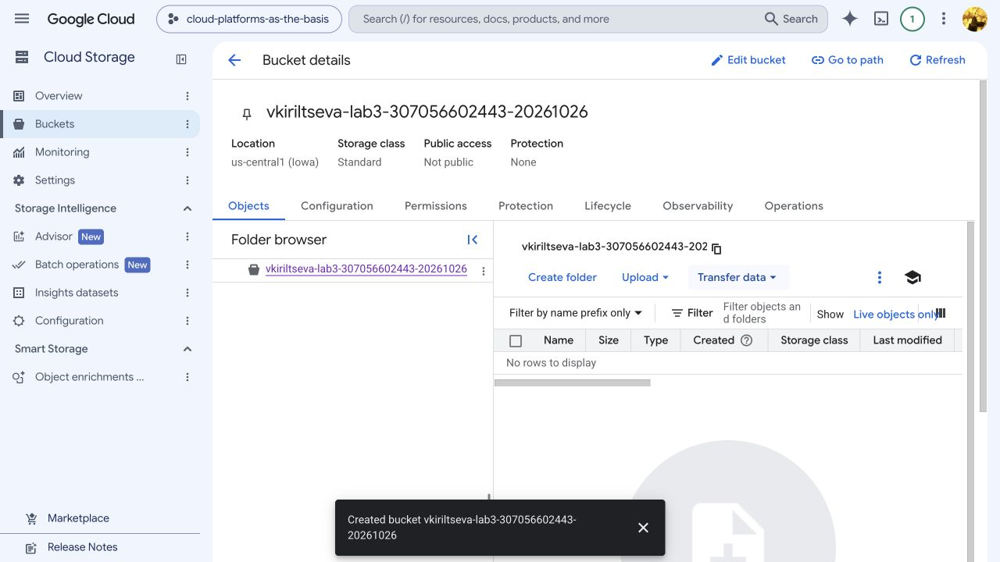
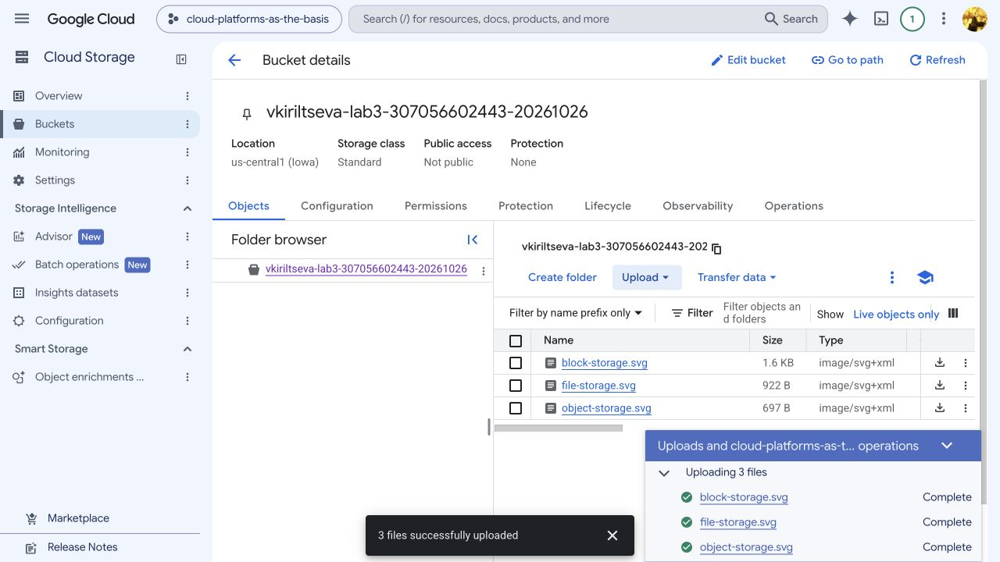
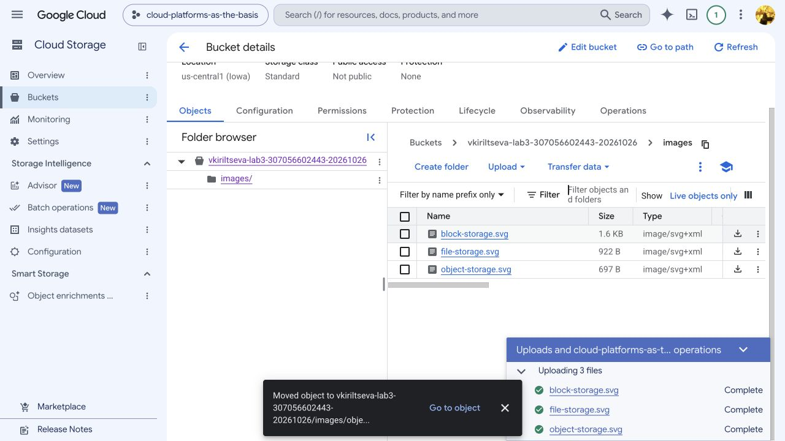
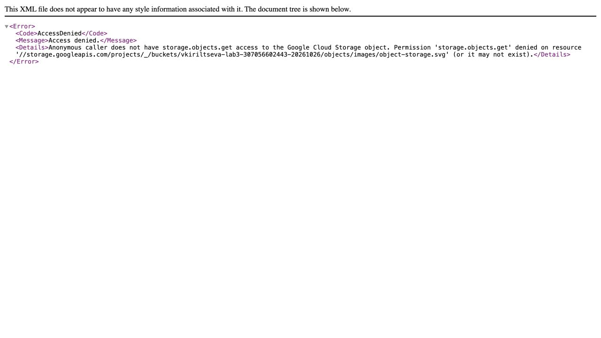
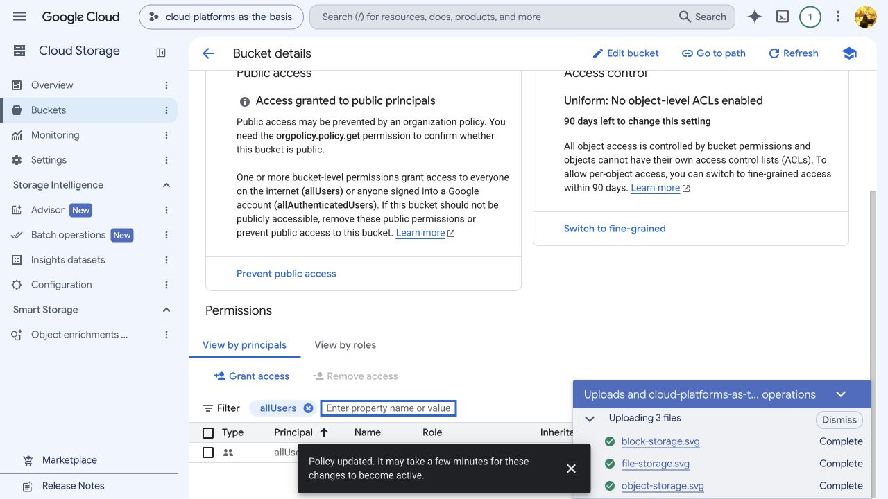
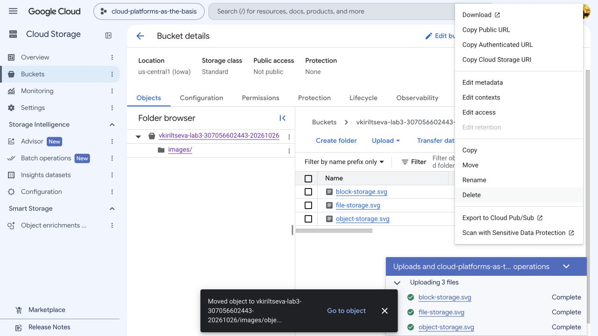
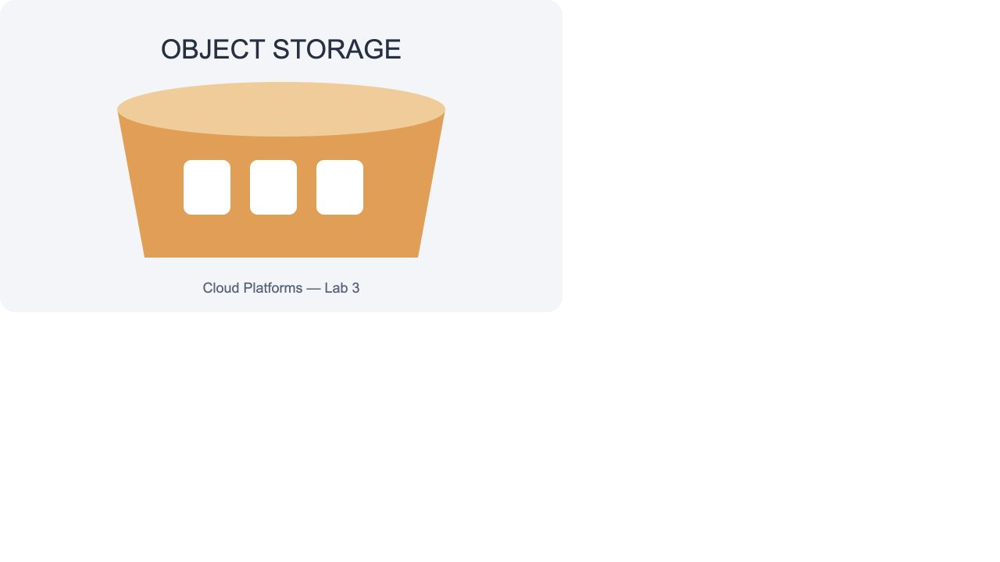
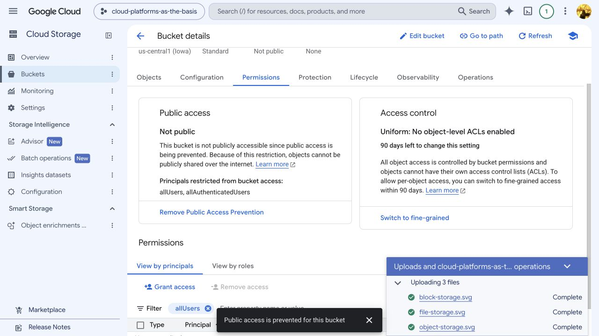
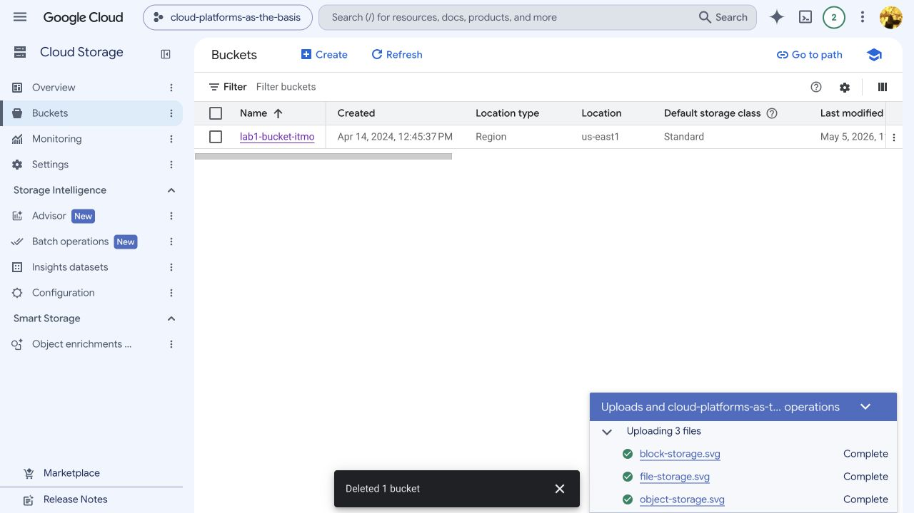

# Лабораторная работа №3. Исследование Cloud Storage

University: [ITMO University](https://itmo.ru/ru/)  
Faculty: [FICT](https://fict.itmo.ru)  
Course: [Cloud platforms as the basis of technology entrepreneurship](https://ex-itmo-ict-faculty.github.io/cloud-platforms-as-the-basis-of-technology-entrepreneurship/)  
Year: 2026  
Group: U4225  
Author: Кирильцева Вероника Сергеевна  
Lab: Lab3  
Date of create: 26.10.2026  
Date of finished: не защищена

## Цель работы

Ознакомиться с основными понятиями облачного хранения, сравнить блочную, файловую и объектную модели. На практике создать бакет Cloud Storage, загрузить изображения, организовать их в папку, настроить публичное чтение и проверить ссылки, затем удалить учебные ресурсы.

## Краткие теоретические сведения

| Модель | Организация данных и доступ | Пример применения |
|---|---|---|
| Блочная | Том состоит из адресуемых блоков; файловую систему обычно создаёт ОС | Диск виртуальной машины, данные СУБД |
| Файловая | Иерархия каталогов и файлов, общий доступ через файловые протоколы, например NFS/SMB | Общая папка приложений или пользователей |
| Объектная | Объект содержит данные и метаданные, имеет имя в бакете; доступ через API/HTTP | Изображения, резервные копии, статические материалы |

Google Cloud Storage — объектное хранилище. В созданном бакете используется **плоское пространство имён**. Папка `images/` в интерфейсе группирует объекты с общим префиксом: полное имя изображения — `images/block-storage.svg`. Это не смонтированный файловый каталог. Режим hierarchical namespace в работе не включался.

## Ход работы

### 1. Выбор проекта и создание бакета

Выполнен вход под Google-аккаунтом автора. Выбран учебный проект `cloud-platforms-as-the-basis`, в котором доступно создание бакетов. В разделе **Cloud Storage → Buckets → Create bucket** создан отдельный бакет:

| Параметр | Значение |
|---|---|
| Имя | `vkiriltseva-lab3-307056602443-20261026` |
| Location type | Region |
| Location | `us-central1` (Iowa) |
| Storage class | Standard |
| Access control | Uniform, IAM на уровне бакета |
| Public Access Prevention при создании | включена |
| Hierarchical namespace | выключен |
| Soft delete, Object Versioning, Retention | выключены |
| Encryption | Google-managed |

Выбран Standard для короткого учебного эксперимента. Временный бакет предназначен только для воспроизводимых тестовых изображений. Soft delete отключён при создании, чтобы после удаления не оставлять сохраняемые копии объектов. Восстановление этих облачных копий после удаления не требуется: оригиналы находятся в репозитории.



### 2. Загрузка изображений

Через **Upload → Upload files** в корень бакета загружены три самостоятельно подготовленные SVG-иллюстрации моделей хранения. Личных данных и секретов в них нет. Исходные файлы сохранены в [images](images/).

| Объект | Размер, байт | Content-Type |
|---|---:|---|
| `block-storage.svg` | 1573 | `image/svg+xml` |
| `file-storage.svg` | 922 | `image/svg+xml` |
| `object-storage.svg` | 697 | `image/svg+xml` |

Консоль показала успешную загрузку всех трёх объектов. Первоначально они отображались как **Not public**.



### 3. Создание папки и перемещение

Кнопкой **Create folder** создана папка `images`. Для каждого изображения в контекстном меню выбрана команда **Move**, в поле Destination указан путь `vkiriltseva-lab3-307056602443-20261026/images/`. Выбраны стандартные права назначения. Перемещение выполнялось по одному объекту; выделение нескольких строк не превращает команду Move отдельного контекстного меню в массовую операцию.

После перемещения в корне осталась папка, внутри которой отображаются все три изображения:

```text
gs://vkiriltseva-lab3-307056602443-20261026/
└── images/
    ├── block-storage.svg
    ├── file-storage.svg
    └── object-storage.svg
```

В плоском бакете такое перемещение меняет имя объекта с помощью копирования и удаления исходного объекта. Время создания новых объектов изменилось, а сохранность содержимого дополнительно проверяется по SHA-256 после скачивания.



### 4. Настройка публичного чтения

До изменения доступа выполнены HTTP GET без учётных данных к трём адресам `https://storage.googleapis.com/<bucket>/images/<name>`. Все ответы — **HTTP 403**.

На вкладке **Permissions** снята **Public Access Prevention**, затем через **Grant access** добавлен участник `allUsers` с ролью **Storage Object Viewer** (`roles/storage.objectViewer`) только на созданный бакет. Подтверждено предупреждение **Allow Public Access**. Общие права учебного проекта не менялись.

Сначала консоль сообщила `Policy was out of date`. В диалоге обновления показано только добавление Storage Object Viewer для allUsers; изменение применено к актуальной версии политики. До завершения сохранения прямые запросы ещё возвращали 403. После успешного `Policy updated` проверка повторена.

Роль разрешает чтение объектов и просмотр их списка, но не запись и не удаление. Поскольку выбран Uniform access, эта политика распространялась на все изображения бакета. Само снятие Public Access Prevention не выдаёт роль, а лишь разрешает публичные привязки, если их не запрещает вышестоящая политика.





### 5. Получение ссылок через контекстное меню

Для каждого изображения открыто контекстное меню **⋮ → Copy Public URL**. Консоль показала уведомление `Public URL copied to clipboard`. Полученный адрес также проверен в карточке объекта в поле **Public URL**.



Адреса эксперимента:

- `https://storage.googleapis.com/vkiriltseva-lab3-307056602443-20261026/images/block-storage.svg`
- `https://storage.googleapis.com/vkiriltseva-lab3-307056602443-20261026/images/file-storage.svg`
- `https://storage.googleapis.com/vkiriltseva-lab3-307056602443-20261026/images/object-storage.svg`

URL — это адрес объекта; само копирование ссылки не выдаёт прав доступа. `Public URL` использует `storage.googleapis.com`, а `Authenticated URL` — `storage.cloud.google.com` и предназначен для доступа со входом. В данном эксперименте публичное чтение обеспечивается IAM-привязкой `allUsers`, а не подписанным URL. После удаления бакета эти адреса больше не служат для просмотра; оригиналы иллюстраций сохранены в репозитории.

Прямые HTTP GET выполнены без заголовка Authorization и без cookies. Получены:

| Файл | До публикации | После публикации | Размер ответа | Содержимое |
|---|---|---|---:|---|
| block-storage.svg | 403 | 200 | 1573 байт | совпало с оригиналом |
| file-storage.svg | 403 | 200 | 922 байт | совпало с оригиналом |
| object-storage.svg | 403 | 200 | 697 байт | совпало с оригиналом |

У всех успешных ответов Content-Type — `image/svg+xml`. Побайтовое сравнение и SHA-256 подтвердили сохранность после перемещения:

```text
block-storage.svg  ddef314b18da285baba9132133a4170c5211e1abc522066f4ce7cc15c65dd1d7
file-storage.svg   ac324dc2d5b6b9edee49f3a525512d7d7455c4fcf690ab661eaf1b59ccadb3b3
object-storage.svg cb62a0c1a5b5a75a14f41009ff5b547a09eb44c7c3209fdad504d69cb075f244
```

В браузере по прямому публичному адресу отобразилась иллюстрация объектного хранилища:



Результаты HTTP-проверок сохранены в [access-checks.json](access-checks.json). В нём сохранены также промежуточные неуспешные проверки: это позволяет отличить попытку применить настройку от фактической доступности данных.

### 6. Удаление ресурсов

На вкладке **Permissions** удалён участник `allUsers`; консоль показала `Removed allUsers` и статус **Not public**. Затем повторно включена Public Access Prevention. При этом немедленные запросы к исходным URL ещё дали HTTP 200. Для проверки возможного влияния кеша выполнены запросы с уникальным query-параметром; все три дали **HTTP 403**. Ранее публично выданные или закешированные копии не отзываются самим удалением роли.



В списке бакетов выбран только `vkiriltseva-lab3-307056602443-20261026`, нажата **Delete**, введено `DELETE`. Бакет удалён вместе с папкой-маркером и изображениями. Soft delete и versioning были отключены при создании, поэтому учебные облачные копии не оставлены для восстановления.

Консоль подтвердила `Deleted 1 bucket`. В списке остался только общий учебный бакет. Дополнительные HTTP GET к каждому прежнему объекту с уникальным query-параметром дали **HTTP 404** и XML-код **NoSuchBucket** — указанный бакет больше не существует.



Виртуальные машины и сервисные аккаунты для Lab3 не создавались. Общий бакет `lab1-bucket-itmo` сохранён.

## Выводы

Исследовано объектное хранилище Cloud Storage и его отличие от блочной и файловой моделей. Создан бакет, загружены и перемещены три изображения, проверена неизменность их содержимого. Публичное чтение настроено через IAM и проверено анонимными HTTP-запросами: 403 до выдачи роли и 200 после её применения. Через контекстное меню получены публичные ссылки. После эксперимента публичная роль снята, запрет публичного доступа восстановлен, бакет и объекты удалены. Работа показала, что URL сам по себе не предоставляет доступ, а при проверке отзыва доступа необходимо учитывать кеширование ранее публичных ответов.

## Источники

- [Правила оформления отчётов](https://ex-itmo-ict-faculty.github.io/cloud-platforms-as-the-basis-of-technology-entrepreneurship/education/labs2023-2024/reportdesign/).
- [Google Cloud: объекты и пространство имён](https://docs.cloud.google.com/storage/docs/objects).
- [Google Cloud: публичный доступ к данным](https://docs.cloud.google.com/storage/docs/access-control/making-data-public).

[К списку отчётов](../README.md)
