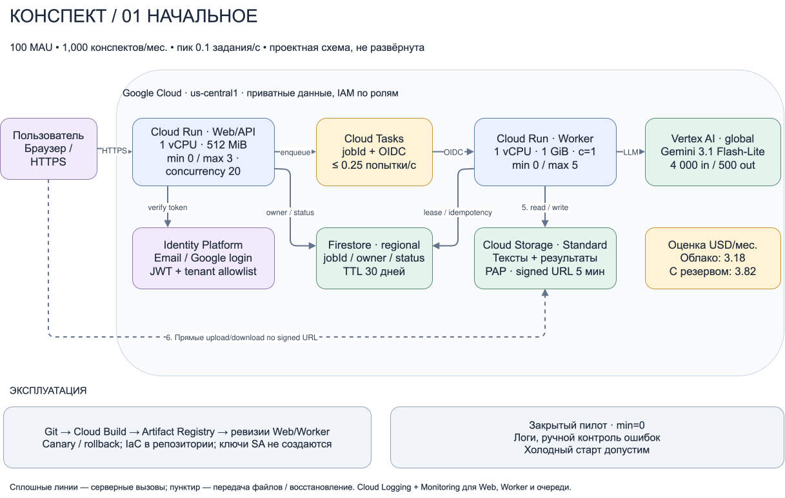
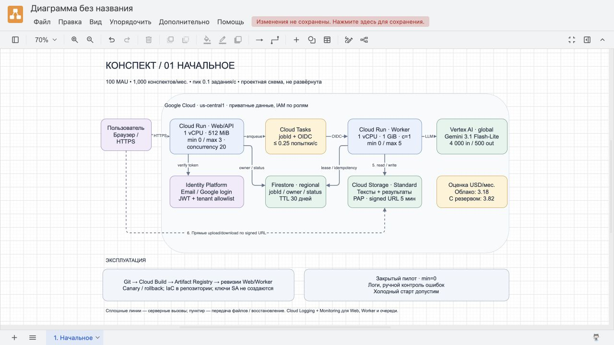
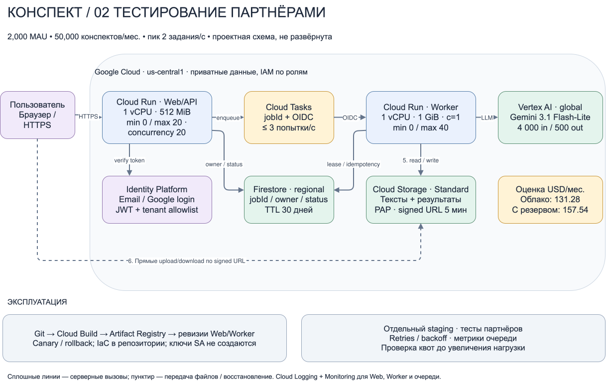
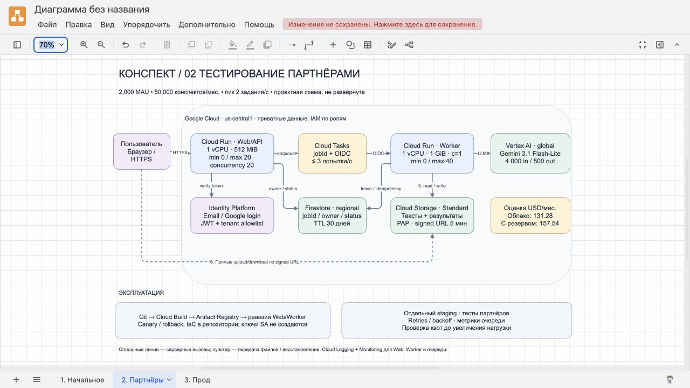
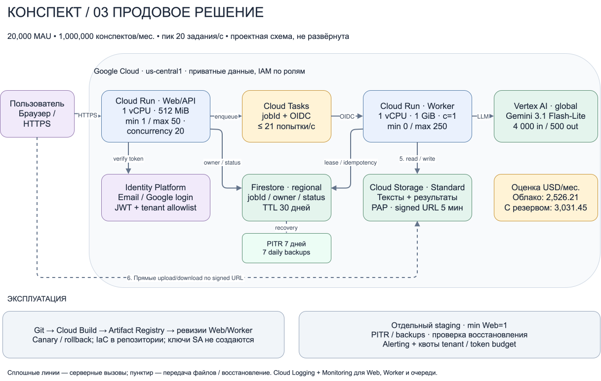
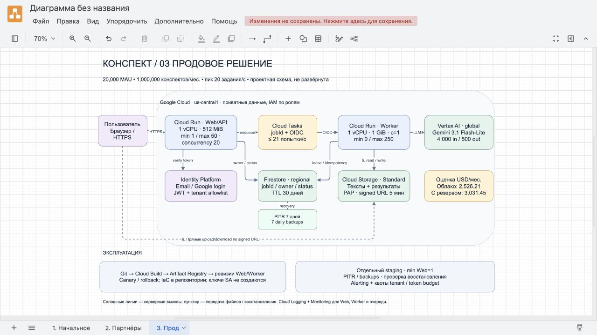
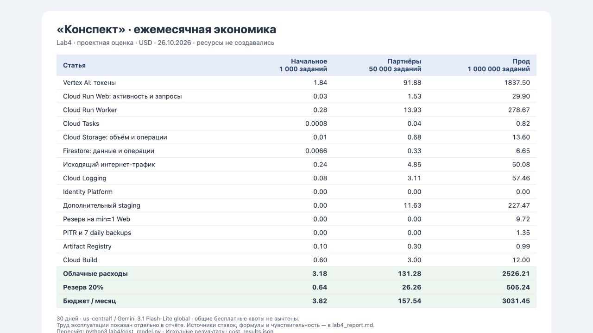

# Лабораторная работа №4. Разработка инфраструктуры MVP AI приложения

University: [ITMO University](https://itmo.ru/ru/)  
Faculty: [FICT](https://fict.itmo.ru)  
Course: [Cloud platforms as the basis of technology entrepreneurship](https://ex-itmo-ict-faculty.github.io/cloud-platforms-as-the-basis-of-technology-entrepreneurship/)  
Year: 2026  
Group: U4225  
Author: Кирильцева Вероника Сергеевна  
Lab: Lab4  
Date of create: 26.10.2026  
Date of finished: не защищена

## Цель и результат

Спроектировать инфраструктуру AI-приложения «Конспект» для начального этапа, тестирования партнёрами и промышленной эксплуатации. Сравнить решения с учётом роста нагрузки и рассчитать ежемесячные расходы.

**Это проектная работа. Облачные ресурсы не создавались, модель AI не вызывалась, деньги на выполнение Lab4 не списывались.** Ниже приведён прогноз содержания будущего приложения, а не фактический счёт Google Cloud. Отдельных исходных данных преподавателя в задании нет; выбор «Конспекта» и собственных допущений согласован с автором работы.

## 1. Приложение и исходные допущения

Пользователь входит по email или Google, загружает текст TXT/Markdown и получает краткий конспект. Есть список собственных заданий, состояния queued/running/done/failed, просмотр и удаление результата. OCR, аудио, обучение модели, поиск в интернете и RAG в MVP не входят.

Ограничения: файл до 2 MiB, вход модели до 8 000 токенов, ответ до 1 000 токенов. Превышающие лимит тексты отклоняются до запуска генерации; средние величины расчёта ниже меньше этих ограничений. Данные хранятся 30 дней. Результат требует проверки пользователем: генерация может пропустить факт или исказить исходный текст.

| Допущение | Начальное | Тестирование партнёрами | Продовое решение |
|---|---:|---:|---:|
| Активных пользователей в месяц (MAU) | 100 | 2 000 | 20 000 |
| Успешных конспектов N/месяц | 1 000 | 50 000 | 1 000 000 |
| Средняя нагрузка N / 2 592 000, заданий/с | 0,000386 | 0,01929 | 0,3858 |
| Предполагаемый пик новых заданий/с | 0,1 | 2 | 20 |
| Среднее время одной попытки Worker | 10 с | 10 с | 10 с |
| Вход / оплачиваемый выход модели | 4 000 / 500 токенов | 4 000 / 500 | 4 000 / 500 |
| Попыток на успешную обработку M/N | 1,05 | 1,05 | 1,05 |
| Дополнительный staging | нет | 10% переменных расходов | 10% переменных расходов |

Месяц расчёта — 30 дней = 720 часов = 2 592 000 секунд. Пики заданы отдельно от среднего: делить месячную нагрузку на секунды недостаточно для выбора мощности. В 500 выходных токенов включены все оплачиваемые выходные токены, в том числе reasoning, если он используется; скрытый расход сверх этого среднего изменит прогноз.

На один конспект приняты 64 KiB входного текста и 8 KiB результата, 4 KiB метаданных Firestore вместе с индексами. Это отдельные инженерные допущения: байты не переводятся в токены по фиксированному универсальному коэффициенту. Каждый MAU посещает сайт 10 раз/месяц, получает по 2 MiB статики за визит (5 HTTP-запросов). На задание приходится ещё 10 API-запросов по 2 KiB ответа и одно скачивание результата 8 KiB. Постоянный polling сверх этого бюджета запрещён.

## 2. Общая архитектура и поток данных

Редактируемый документ **[konspekt-infrastructure.drawio](diagrams/konspekt-infrastructure.drawio)** содержит три страницы. Схемы открыты, проверены и экспортированы в draw.io; векторные версии сохраняют читаемость при увеличении:

- [Начальное состояние — SVG](diagrams/01-initial.svg).
- [Тестирование партнёрами — SVG](diagrams/02-partners.svg).
- [Продовое решение — SVG](diagrams/03-production.svg).

1. Браузер получает SPA от Cloud Run Web и входит через Identity Platform. API проверяет JWT, владельца данных и лимиты пользователя. Пилот доступен только участникам allowlist.
2. API выдаёт короткую signed URL на загрузку строго определённого объекта в приватный Cloud Storage. Бакет не публикуется через allUsers; Public Access Prevention остаётся включённой. Загружаемые файлы не проходят через контейнер API.
3. После проверки загрузки API создаёт запись задания в Firestore и задачу Cloud Tasks с `jobId`. Ответ HTTP 202 выдаётся только после принятия задачи очередью. Повтор запроса с тем же idempotency key не создаёт новое оплачиваемое задание. При сбое enqueue клиент повторяет запрос; незавершённая запись без подтверждённого задания удаляется TTL.
4. Cloud Tasks вызывает отдельный приватный Cloud Run Worker с OIDC. Он получает объект, вызывает Gemini через Vertex AI с ADC, сохраняет результат и обновляет статус. У Worker нет публичного unauthenticated invoke.
5. Браузер проверяет статус с ограниченным exponential polling. API выдаёт signed URL на чтение результата только владельцу, со сроком 5 минут.

Firestore-транзакция и lease защищают обработку от параллельных дублей. Доставка очереди повторяемая, поэтому нельзя обещать exactly-once вызов AI: сбой после ответа модели, но до записи результата может привести к повторной оплате. Коэффициент 1,05 предусматривает такие повторы; реальную величину нужно измерить. Retry с backoff, максимум 5 попыток, затем failed с возможностью ручного повтора; бесконечных повторов нет. Таймаут обработки и deadline задачи согласованы (например 60 с), генерация прерывается раньше deadline.

## 3. Три состояния инфраструктуры

### 3.1. Начальное состояние

Один регион `us-central1`, один проект pilot, Cloud Run Web и Worker масштабируются до нуля. Web: 1 vCPU, 512 MiB, concurrency 20, min=0/max=3. Worker: 1 vCPU, 1 GiB, concurrency 1, min=0/max=5. Cloud Tasks ограничивает доставку 0,25 попытки/с. Приватный Standard-бакет, региональный Firestore, ручная проверка ошибок и базовые метрики. Допустимы холодные старты и отсутствие круглосуточной поддержки.





### 3.2. Тестирование партнёрами

Отдельные проекты/окружения pilot и staging, без доступа staging к реальным документам. Web min=0/max=20, Worker min=0/max=40; доставка до 3 попыток/с. Сохраняются те же контейнеры, API и структура данных. Добавляются tenant ID, квоты партнёров, тестирование повторной доставки и rollback, метрики длины и возраста очереди, ошибки модели, задержки и расход токенов. Staging ограничен 10% переменного бюджета, использует синтетические документы; это финансовый лимит, а не полная копия партнёрской нагрузки.





### 3.3. Продовое решение

Отдельные prod и staging; Web min=1/max=50 для уменьшения холодных стартов. Worker min=0/max=250, очередь до 21 попытки/с. Firestore PITR и ежедневные managed backups с хранением 7 копий, алерты и процедура восстановления. Cloud Storage: жизненный цикл 30 дней, soft delete 7 дней. Перезапись больших объектов не входит в модель; при её появлении расходы на версии и soft delete нужно увеличить.

В схеме региональное решение, рассчитанное на зональную отказоустойчивость управляемых сервисов. Резервный регион не развёрнут. Цели — доступность API 99,5%, восстановление после логической ошибки до 4 часов, резервная копия не старше 24 часов. Это проектные цели, требующие испытаний; при отказе всего региона RTO не гарантируется. Для более строгого SLA нужны второй регион, репликация и новый расчёт. PITR/backup Firestore не заменяет защиту самих файлов; для них используется soft delete.





### Проверка пиковой мощности

При concurrency Worker=1 требуемое число активных экземпляров оценивается как `ceil(пик × 1,05 × 10 с)`: **2 / 21 / 210**. Это меньше выбранных максимумов 5 / 40 / 250. Максимумы — ограничение масштабирования, а не постоянно оплачиваемые VM.

Для прода модель должна выдерживать приблизительно 1 260 попыток/мин, 5,04 млн входных и 630 тыс. выходных токенов/мин на пике. До запуска необходимо проверить квоты Cloud Run CPU/instances, Cloud Tasks и пропускную способность модели. Наличие таких квот в учебном аккаунте не проверялось. При 429 очередь замедляется; max instances не гарантирует доступность модели и не является жёстким лимитом расходов.

## 4. Обоснование выбора ресурсов

| Решение | Почему выбрано и как развивается |
|---|---|
| Cloud Run для Web и Worker | Контейнеры и scale-to-zero на пилоте; независимое масштабирование UI/API и долгой AI-операции. Один тёплый Web в проде стоит меньше, чем постоянное содержание всех воркеров |
| Cloud Tasks с первого этапа | Буфер пиков, управляемые повторы и ограничение скорости обращений к AI. Экономия на отказе от очереди на пилоте — доли цента, а переход с синхронной схемы потребует изменения API |
| Vertex AI Gemini 3.1 Flash-Lite | Выбрана для расчёта по опубликованным standard global token rates. Нет собственной GPU, обучения и администрирования inference-сервера. Качество и актуальность модели нужно проверить до реального внедрения; модель скрыта за адаптером |
| Firestore regional | Небольшие записи заданий и владельцев, транзакции lease/idempotency, отсутствие постоянно работающего SQL-сервера. Случайные jobId, индексы только для нужных запросов; большие тексты хранятся отдельно |
| Cloud Storage Standard | Дешёвое хранение файлов, прямые загрузки/скачивания и lifecycle. Архивные классы для 30-дневного активно читаемого корпуса не нужны |
| Identity Platform | Email/социальный вход; нет самодельного хранения паролей. SMS и SAML не входят в расчёт |
| Cloud Build + Artifact Registry | Сборки, версии контейнеров, canary и возврат на предыдущую ревизию. Один пайплайн проходит pilot/staging/prod |
| Logging + Monitoring | Статусы запросов, latency, 429/5xx, возраст очереди, ошибки и token usage. Тексты документов и JWT в логи не попадают |

Самая дешёвая на старте схема «один синхронный контейнер без очереди» проигрывает при росте: браузер ждёт генерацию, повторы неоднозначны, пик бьёт напрямую в модель. Выбранная схема немного сложнее с первого дня, зато не требует миграции хранения и переписывания пользовательского сценария. VM/GKE/GPU и SQL не добавляются только из-за перехода к продовому этапу: для данной нагрузки их дополнительные постоянные ресурсы и эксплуатация пока не обоснованы. Решение пересматривается по измеренным нагрузкам, а не по названию этапа.

## 5. Экономическая модель

### 5.1. Тарифы и границы оценки

Тарифы проверены **26.10.2026**, USD, on-demand, регион `us-central1` для региональных сервисов; Gemini — global endpoint. Global endpoint не обеспечивает фиксацию обработки текста в одном регионе. Проект не предполагает обязательной локализации данных; при её необходимости выбираются другой endpoint/регион и новый тариф.

| Ресурс | Ставка, использованная в расчёте | Официальный источник |
|---|---|---|
| Cloud Run request-based | CPU $0,000024/vCPU·с; RAM $0,0000025/GiB·с; запросы $0,40/млн; idle CPU min instance $0,0000025/vCPU·с | [Cloud Run pricing](https://cloud.google.com/run/pricing) |
| Gemini 3.1 Flash-Lite, standard global | $0,25/млн входных; $1,50/млн выходных токенов | [Vertex AI / Agent Platform pricing](https://cloud.google.com/vertex-ai/generative-ai/pricing) |
| GCS Standard Iowa, flat namespace | $0,000027397/GiB·час; Class A $0,005/1 000; Class B $0,0004/1 000 | [Storage pricing](https://cloud.google.com/storage/pricing) |
| Firestore Iowa, Standard edition | чтение $0,03/100 тыс.; запись $0,09/100 тыс.; удаление $0,01/100 тыс.; данные/PITR $0,000205479/GiB·час; backup $0,000041096/GiB·час | [Firestore pricing](https://cloud.google.com/firestore/pricing) |
| Cloud Tasks | $0,40/млн операций, единица до 32 KiB | [Tasks pricing](https://cloud.google.com/tasks/pricing) |
| Интернет-трафик к пользователям в Европе | $0,12/GiB, объёмы Web менее 1 TiB; GCS также $0,12/GiB в нужном диапазоне | [Network pricing](https://cloud.google.com/vpc/network-pricing), [Storage pricing](https://cloud.google.com/storage/pricing) |
| Cloud Logging | $0,50/GiB поступивших логов, хранение до 30 дней | [Observability pricing](https://cloud.google.com/products/observability/pricing) |
| Artifact Registry | $0,000136986/GiB·час | [Artifact Registry pricing](https://cloud.google.com/artifact-registry/pricing) |
| Cloud Build e2-standard-2 | $0,006/мин | [Cloud Build pricing](https://cloud.google.com/build/pricing) |
| Identity Platform email/social | 0 USD при MAU до 50 тыс.; без SMS/SAML | [Identity Platform pricing](https://cloud.google.com/identity-platform/pricing) |

Общие бесплатные квоты Cloud Run, Storage, Firestore, Tasks, Logging, Registry и Build **не вычтены**: они могут быть заняты другими проектами billing account. Фактическая оплата при доступных квотах будет ниже. Для Identity Platform применена опубликованная нулевая ступень MAU выбранного способа входа. Кредиты, CUD, batch, context caching и временные скидки не используются. Расчёт выполнен по standard, а не по более дешёвым Flex/Batch token rates.

Все почасовые цены хранения умножаются именно на 720 часов. Учитываются два приложения и очередь, AI, данные, запросы, исходящий трафик, логи, сборки и образы. Для Monitoring используются стандартные метрики Google Cloud; платные custom metrics, synthetic monitors, tracing и advanced audit logs не включаются. Собственный домен, налоги, платная поддержка и первоначальная разработка не входят. Труд эксплуатации приведён отдельно как **условные** 2/6/16 ч × $15/ч, а не рыночная оценка зарплаты.

### 5.2. Формулы и объёмы

`M = 1,05N` — эквивалент оплачиваемых попыток, с одинаковым средним расходом токенов. Это консервативно учитывает часть повторов, но не обещает, что каждый ошибочный запрос к AI тарифицируется.

```text
AI = M × (4000 × 0,25 + 500 × 1,50) / 1 000 000
Rweb = 10N + 50U                         # API + SPA assets
Tweb = N + 0,5U секунд                   # 0,1 с/API; 0,01 с/asset
Web = Tweb × (1×0,000024 + 0,5×0,0000025) + Rweb×0,40/1e6
Worker = 10M × (1×0,000024 + 1×0,0000025) + M×0,40/1e6
Tasks = (N + M) × 0,40/1e6               # create + delivery; body <32 KiB
GCS GiB = N × 72 KiB × (37/30) / 2^30    # 30 дней + soft delete 7 дней
GCS operations: Class A = N+M; Class B = 4M; deletes бесплатны
Firestore: reads=10M; writes=3M; deletes=N; storage=N×4 KiB/2^30
Egress GiB = (U×20 MiB + N×28 KiB)/2^30
Logs GiB = (Rweb+M)×10 KiB/2^30
```

Время Worker 10 с включает ожидание AI и усреднённые накладные расходы запуска; request-based billing продолжает начисляться во время активного HTTP-запроса к Worker, даже если он ждёт модель. Для Web возможное перекрытие concurrent-запросов не вычтено, поэтому оценка активности завышена относительно идеальной утилизации. В проде дополнительно заложен полный idle-месяц для одного Web (CPU+512 MiB = $9,72); добавление его поверх активности — консервативный запас, а не точное разделение секунд busy/idle.

Данные оценены в устойчивом режиме после заполнения 30-дневного окна; в первый месяц объём может быть меньше. Для PITR принят объём, равный основной Firestore DB; семь ежедневных backup-копий — семь таких объёмов. Высокая изменяемость может увеличить эти величины. Staging = 10% суммы переменных статей, без удвоения CI/Registry. Образы: 1/3/10 GiB; сборки: 100/500/2 000 минут. К сумме всех статей добавлен резерв 20%.

### 5.3. Расходы по этапам

| Статья, USD/месяц | Начальное | Партнёры | Прод |
|---|---:|---:|---:|
| Vertex AI: токены | 1.84 | 91.88 | 1837.50 |
| Cloud Run Web: активность и запросы | 0.03 | 1.53 | 29.90 |
| Cloud Run Worker | 0.28 | 13.93 | 278.67 |
| Cloud Tasks | 0.0008 | 0.04 | 0.82 |
| Cloud Storage: объём и операции | 0.01 | 0.68 | 13.60 |
| Firestore: данные и операции | 0.0066 | 0.33 | 6.65 |
| Исходящий интернет-трафик | 0.24 | 4.85 | 50.08 |
| Cloud Logging | 0.08 | 3.11 | 57.46 |
| Identity Platform | 0.00 | 0.00 | 0.00 |
| Дополнительный staging | 0.00 | 11.63 | 227.47 |
| Резерв на min=1 Web | 0.00 | 0.00 | 9.72 |
| PITR и 7 daily backups | 0.00 | 0.00 | 1.35 |
| Artifact Registry | 0.10 | 0.30 | 0.99 |
| Cloud Build | 0.60 | 3.00 | 12.00 |
| **Всего облако** | **3.18** | **131.28** | **2526.21** |
| **Резерв 20%** | **0.64** | **26.26** | **505.24** |
| **Бюджет с резервом** | **3.82** | **157.54** | **3031.45** |
| **Эксплуатационный труд** | **30.00** | **90.00** | **240.00** |
| **Общий бюджет с трудом** | **33.82** | **247.54** | **3271.45** |


Небольшие статьи менее цента показаны с четырьмя знаками. Итоги округлены только после суммирования исходных величин.

| Этап | Обработок/мес. | Облако + 20%, USD | USD/конспект |
|---|---:|---:|---:|
| Начальное | 1,000 | 3.82 | 0.003819 |
| Тестирование партнёрами | 50,000 | 157.54 | 0.003151 |
| Продовое решение | 1,000,000 | 3031.45 | 0.003031 |


Снижение удельной стоимости связано с распределением фиксированных затрат сборки и минимального экземпляра, а не со снижением цены токена. В проде AI составляет около 73% прямых облачных расходов. Поэтому рост токенов влияет на экономику сильнее, чем экономия нескольких гигабайт хранения.



### 5.4. Чувствительность и контроль расходов

| Сценарий для прода | Бюджет с резервом, USD/мес. | Изменение |
|---|---:|---:|
| Базовый | 3031.45 | +0.0% |
| Вход 8 000 вместо 4 000 токенов | 4417.45 | +45.7% |
| Выход 1 000 вместо 500 токенов | 4070.95 | +34.3% |
| Worker 30 с вместо 10 с | 3766.03 | +24.2% |
| 1,20 попытки вместо 1,05 | 3433.96 | +13.3% |


При времени Worker 30 с пик требует уже `ceil(20 × 1,05 × 30) = 630` экземпляров: существующего max=250 недостаточно. Указанный бюджет — пересчёт ресурсо-секунд, а не подтверждение прежней задержки; нужно повысить квоты/лимиты или принять рост очереди. При коэффициенте попыток 1,20 пик требует 24 попытки/с, что выше dispatch=21; настройку очереди также нужно пересмотреть после проверки квот AI.

Практические меры: ограничение входных/выходных токенов, лимит заданий пользователя, tenant budget, остановка при превышении дневного token budget, контролируемый retry и queue dispatch. Budget alerts только уведомляют и сами не останавливают начисления. Для Worker в базовом расчёте оставлена concurrency=1. Более высокая concurrency может снизить compute-затраты на ожидание, но сначала нужны измерения памяти, CPU и соблюдения квот модели. Повышать её «на бумаге» и делить цену на десять нельзя.

При подтверждённой стабильной фоновой нагрузке можно отдельно сравнить instance-based billing/CUD; при больших документах — пакетную обработку, если допустима задержка. Любой переход требует повторной оценки качества, задержек, quota и стоимости. Модель AI меняется через адаптер, без миграции объектов и заданий.

## 6. Надёжность, безопасность и проверка перед внедрением

- Раздельные service accounts для Web, Tasks invoker, Worker и CI. Минимальные роли, без JSON-ключей и project Editor. Web имеет право enqueue и ограниченное подписание URL через dedicated signer; Worker — читать входы, записывать результаты и вызывать AI. Пользователь не получает IAM-доступ ко всему бакету.
- API проверяет владельца и tenant ID; произвольные пути в signed URL недопустимы. Бакеты приватные, CORS только для домена приложения, короткие ссылки. Запросы к AI выполняет сервер, а не браузер с API-ключом.
- Идемпотентность, lease, ограниченные повторы и дедупликация результатов. Ошибки 429/5xx отделяются от отклонённых форматов и превышения лимитов.
- До перехода к партнёрам — тесты качества на эталонных конспектах, отказ очереди и модели, повторная доставка, проверка межпользовательского доступа. До прода — нагрузочный тест 20 новых заданий/с с учётом повторов, проверка масштабирования и квот, тренировка восстановления. Это план проверок; сами испытания не проводились в Lab4.
- Алерты на возраст очереди, p95 длительности, долю failed, расход токенов и дневные расходы. Логи без пользовательских текстов; срок хранения и удаление распространяются на резервные копии согласно принятой политике.

## 7. Воспроизводимость и выводы

Исходный расчёт — [cost_model.py](cost_model.py), полные неокруглённые результаты — [cost_results.json](cost_results.json), статическая сводка расчёта — [cost-summary.html](cost-summary.html). Пересчёт не использует сеть и не создаёт ресурсы:

```bash
python3 lab4/cost_model.py
```

Проверены суммы статей, резерв 20%, независимый пример AI для прода ($1 837,50), число требуемых Worker на пике и наличие трёх страниц в реальном экспорте draw.io. Схемы проверены визуально, а ссылки на файлы — перед публикацией.

Спроектировано три состояния одного AI-сервиса с общей базой Web → очередь → Worker → модель. На пилоте решение масштабируется до нуля, при тестировании добавляется изоляция партнёров и staging, в проде — тёплый Web и восстановление данных. При согласованных допущениях бюджет инфраструктуры с 20% резервом составляет **$3,82 / $157,54 / $3 031,45 в месяц**. Самая существенная статья — генерация AI, поэтому экономику определяют длина текста, длина ответа и повторные попытки. Облачные сервисы в Lab4 не создавались; удалять новые ресурсы не требуется.

[К списку отчётов](../README.md)
